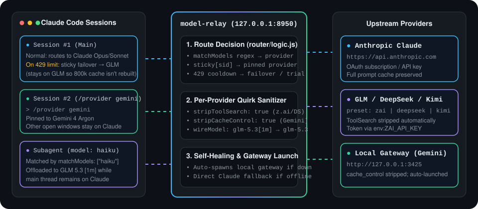

<p align="center">
  <picture>
    <source media="(prefers-color-scheme: dark)" srcset="docs/assets/banner-dark.svg">
    
  </picture>
</p>

<p align="center">
  <b>Keep working when Claude hits a 5-hour usage limit, offload subagents,<br>and switch any window from an interactive panel—without rebuilding 800k prompt caches.</b>
</p>

<p align="center">
  <a href="https://github.com/cablate/model-relay/releases"></a>
  <a href="https://github.com/cablate/model-relay/actions/workflows/ci.yml"></a>
  
  <a href="LICENSE"></a>
</p>

<p align="center">
  <b>English</b> · <a href="README.zh-TW.md">繁體中文</a> · <a href="#install">Install</a> · <a href="#whats-inside">Features</a> · <a href="#configuration">Configuration</a> · <a href="CHANGELOG.md">Changelog</a>
</p>

<p align="center">
  
</p>

## Why

Long Claude Code sessions run into four costly routing problems. `model-relay` solves them on localhost (`127.0.0.1:8950`) with zero external proxies.

| When… | Without `model-relay` | With `model-relay` |
|---|---|---|
| Claude hits a 5-hour usage limit (HTTP 429) mid-turn | Your turn fails and the conversation stops until quota resets | The same request automatically fails over to your backup provider and completes |
| Claude quota recovers 10 minutes later | Switching a 620k-token chat back to Claude resends all 620k tokens and burns fresh quota | Sticky sessions stay on the backup provider for 7 days; only new chats return to Claude |
| You want `haiku` subagents on a fast/cheap endpoint | Changing global env vars forces your main Opus/Sonnet thread onto that endpoint too | `matchModels` routes `haiku` subagents to GLM/DeepSeek while your main thread stays on Claude |
| You want to switch just one window to Gemini or GLM | Editing `settings.json` switches every open terminal at once | Type `/provider` to open the interactive panel and pin only the current window |
| Third-party gateways choke on `ToolSearch` or `cache_control` | All tools vanish or requests fail with HTTP 400 | Per-provider `stripToolSearch` and `stripCacheControl` clean requests on the fly |

## Install

Requires Node.js 20+ and Claude Code 2.1.287 or later (tested on Node.js 22.23.2 and Claude Code 2.1.302).

```sh
claude plugin marketplace add cablate/model-relay
claude plugin install model-relay@model-relay
```

Initialize `~/.claude/model-relay.json`, wire `ANTHROPIC_BASE_URL` into `~/.claude/settings.json`, and verify your upstream providers with one command:

```bash
node tools/setup.mjs init --fix
export ZAI_API_KEY="your-api-key"
node tools/setup.mjs doctor --ping
```

Expected output:

```text
Config OK (~/.claude/model-relay.json)
  Port: 8950
  Providers: glm -> glm-5.3[1m], gemini -> gemini-4-argon
  Failover: glm (cooldown 600s)
  Claude settings: ✓ settings.json ANTHROPIC_BASE_URL=http://127.0.0.1:8950
  Router health: {"ok":true,"pid":38780,"failoverSince":0,"nextClaudeTry":0,"failoverProvider":"glm"}
  Upstream ping:
    ✓ glm        (glm-5.3[1m]) -> HTTP 200 in 1950ms
    ✓ gemini     (gemini-4-argon) -> HTTP 200 in 1420ms
```

Update with `claude plugin update model-relay@model-relay`.

## Who this is for

`model-relay` is built for Claude Code users who combine a Claude subscription with backup or specialized endpoints (GLM `z.ai`, DeepSeek, Kimi, MiniMax, OpenRouter, or a local Gemini gateway). If you need a multi-tenant cloud proxy for an entire organization, use LiteLLM instead—`model-relay` is a single-user localhost daemon.

## What's inside

<p align="center">
  
</p>

### Interactive `AbovePrompt` control panel and live latency ping

Type `/provider` (or `/provider panel`) to open an interactive control panel right above your prompt input box. Click buttons or press `ctrl+x tab` to use keyboard hotkeys (`1`–`9` to switch routes, `p` to ping live latency across all providers, `r` to reset 429 cooldown). Switching a pinned session back to Claude requires a two-click confirmation so you never accidentally rebuild a massive prompt cache.

### Cache-safe sticky 429 failover

When Anthropic returns a 429 usage-limit response, the router immediately forwards the request to your configured `failover.provider` and pins that session ID for 7 days. After `cooldownMs` (default 10 minutes), new sessions probe Claude again while existing sticky sessions stay on their backup provider.

### Built-in provider presets and local gateway auto-launch

Use built-in presets (`zai`, `glm`, `deepseek`, `kimi`, `minimax`, `openrouter`, `gemini`, `magpie`) so you only need to supply `token` (or `"env:VAR_NAME"`). For local gateways on `127.0.0.1`, set `launch: { command, args }` and the router will automatically spawn the gateway process whenever its port is closed.

## Configuration

Configuration lives in `~/.claude/model-relay.json` (or legacy `~/.claude/custom-agent.json`). The directory defaults to `$CLAUDE_CONFIG_DIR` when set, falling back to `$USERPROFILE/.claude` or `$HOME/.claude`.

| Field | Default | Meaning |
|---|---|---|
| `port` | `8950` | Localhost port for the relay HTTP server (`1025`–`65535`) |
| `claudeUrl` | `"https://api.anthropic.com"` | Upstream Anthropic API base URL |
| `failover.enabled` | `true` | Automatically switch to `failover.provider` on Claude 429 usage limits |
| `failover.provider` | `"glm"` (or first provider) | Provider key used for 429 failover |
| `failover.cooldownMs` | `600000` | Milliseconds before probing Claude again for new sessions (10 minutes) |
| `providers.<name>.preset` | `<name>` | Optional preset (`zai`, `glm`, `deepseek`, `kimi`, `minimax`, `openrouter`, `gemini`, `magpie`) |
| `providers.<name>.baseUrl` | (from preset) | Anthropic-compatible upstream URL for this provider |
| `providers.<name>.token` | (required) | Literal token or `"env:ENV_VAR_NAME"` |
| `providers.<name>.model` | (from preset) | Target model ID when rewriting requests (suffixes like `[1m]` are stripped on wire) |
| `providers.<name>.matchModels` | `["^<name>"]` | Regex patterns matched against incoming request `model` |
| `providers.<name>.stripToolSearch` | `true` | Strip `ToolSearch` and `defer_loading: true` tools from requests |
| `providers.<name>.stripCacheControl` | `false` | Recursively remove `cache_control` fields before forwarding |
| `providers.<name>.authHeader` | `"both"` | How to send credentials: `"bearer"`, `"x-api-key"`, or `"both"` |
| `providers.<name>.launch` | `null` | `{ "command": "...", "args": [...] }` to auto-spawn if localhost port is closed |

## Commands

| Command | Description |
|---|---|
| `/provider` | Open the interactive control panel above the prompt and show current routing status |
| `/provider panel` | Toggle the interactive `AbovePrompt` control panel open or closed |
| `/provider <name>` | Pin the current conversation to provider `<name>` (e.g. `/provider glm`, `/provider gemini`) |
| `/provider claude` | Switch the current conversation back to Claude (rebuilds prompt cache on next turn) |
| `/provider ping` | Probe live latency and HTTP status across all configured providers |
| `/provider probe` | Reset the 429 cooldown timer so the next new session tries Claude immediately |

## Cost, privacy, and permissions

- **Network and data flow:** The router listens only on `127.0.0.1:<port>`. Requests go strictly to `claudeUrl` (`https://api.anthropic.com`) or the `baseUrl` endpoints you configure. `/provider ping` sends a `max_tokens: 1` request to each configured provider when you trigger it. No telemetry or analytics exist.
- **Local files:** Reads `~/.claude/model-relay.json` (or `custom-agent.json`) and writes session sticky state to `~/.claude/model-relay-state.json` plus local logs (`custom-agent-router.log` and `custom-agent-requests.log`, auto-truncated at 5 MB).
- **Plugin permissions:** Inspect all hooks, state keys, and env access at any time by running `claude plugin validate /path/to/model-relay`.

## Supported environments

| Environment | Status |
|---|---|
| Windows 11 + Node.js 22 + Git Bash / PowerShell | Tested |
| macOS / Linux + Node.js 20+ (`sh` + `curl`) | Per official Node.js & POSIX specs (CI matrix tested) |

## Limitations

- **Requires an Anthropic-compatible `/v1/messages` endpoint:** Providers that only speak OpenAI Chat Completions require a local translation proxy (and can be supervised via `providers.<name>.launch`).
- **Switching back to Claude mid-session rebuilds cache:** Because prompt caches do not transfer across providers, `/provider claude` on a long conversation will resend the full conversation history to Anthropic.

## Troubleshooting

| Symptom | What to check |
|---|---|
| `/provider` says config is missing or invalid | Run `node tools/setup.mjs doctor` to verify JSON syntax and check if any `env:VAR` variables are unset in your shell |
| Status bar shows `Relay offline: connected directly to Claude` | The plugin automatically bypassed a stopped router so your chat keeps working; run `node tools/setup.mjs doctor` or check `~/.claude/custom-agent-router.log` |
| Tools are missing on a third-party provider | Set `"stripToolSearch": true` on that provider in `model-relay.json` so `ToolSearch` does not hide other tools |

## Uninstall

1. Run `claude plugin uninstall model-relay@model-relay` and remove `ANTHROPIC_BASE_URL` from `~/.claude/settings.json`.
2. Delete optional state files (`~/.claude/model-relay.json`, `~/.claude/model-relay-state.json`, `~/.claude/custom-agent-router.log`, `~/.claude/custom-agent-requests.log`).

## Run from source

```bash
node tools/check.mjs
claude plugin validate .
claude plugin test .
```

See [CONTRIBUTING.md](CONTRIBUTING.md) for architecture and release steps.

## More

- [Changelog](CHANGELOG.md)
- [Contributing](CONTRIBUTING.md)
- [Security Policy](SECURITY.md)
- [License (MIT)](LICENSE)
