<p align="center">
  <picture>
    <source media="(prefers-color-scheme: dark)" srcset="docs/assets/banner-dark.zh-TW.svg">
    
  </picture>
</p>

<p align="center">
  <b>遇到 Claude 5 小時額度上限時當場無縫接手、把子代理分流給快速模型，<br>還能從輸入框上方的互動面板一鍵切換單一視窗——絕不白白重建 80 萬快取。</b>
</p>

<p align="center">
  <a href="https://github.com/cablate/model-relay/releases"></a>
  <a href="https://github.com/cablate/model-relay/actions/workflows/ci.yml"></a>
  
  <a href="LICENSE"></a>
</p>

<p align="center">
  <a href="README.md">English</a> · <b>繁體中文</b> · <a href="#安裝">安裝</a> · <a href="#功能">功能</a> · <a href="#設定">設定</a> · <a href="CHANGELOG.zh-TW.md">更新紀錄</a>
</p>

<p align="center">
  
</p>

## 為什麼需要

長時間使用 Claude Code 常撞上四個既中斷心流又浪費額度的路由問題。`model-relay` 在本機端（`127.0.0.1:8950`）直接解決它們，不需要依賴外部雲端代理。

| 當… | 沒裝 `model-relay` | 裝了 `model-relay` |
|---|---|---|
| 寫到一半遇到 Claude 5 小時額度上限（HTTP 429） | 這一輪直接報錯中斷，只能等額度重置或關視窗改環境變數 | 同一個請求當場自動轉給備援供應商完成回覆，工作完全不中斷 |
| 10 分鐘後 Claude 額度恢復了 | 把 620k token 的長對話切回 Claude 會全價重送 620k 快取，瞬間燒光額度 | 已切走的長對話固定留在備援供應商（7 天有效）；只有新開的對話回到 Claude |
| 想把 `haiku` 子代理交給便宜快速的模型 | 改全域環境變數會連主線的 Opus/Sonnet 一起換掉 | 透過 `matchModels` 把 `haiku` 子代理導向 GLM/DeepSeek，主線繼續留在 Claude |
| 只想把眼前這一個視窗切去 Gemini 或 GLM | 改 `settings.json` 會把所有開著的終端機視窗一起換掉 | 輸入 `/provider` 打開輸入框上方的互動面板，只固定當前視窗 |
| 第三方轉發站遇到 `ToolSearch` 或 `cache_control` 報錯 | 工具整批消失或請求直接回 HTTP 400 | 每個供應商可獨立設定 `stripToolSearch` 與 `stripCacheControl` 自動清洗請求 |

## 安裝

需要 Node.js 20+ 與 Claude Code 2.1.287 以上（已於 Node.js 22.23.2 及 Claude Code 2.1.302 實測）。

```sh
claude plugin marketplace add cablate/model-relay
claude plugin install model-relay@model-relay
```

初始化 `~/.claude/model-relay.json`、自動將 `ANTHROPIC_BASE_URL` 寫入 `~/.claude/settings.json`，並用一行指令實測所有上游供應商連線：

```bash
node tools/setup.mjs init --fix
export ZAI_API_KEY="your-api-key"
node tools/setup.mjs doctor --ping
```

確認成功的輸出：

```text
Config OK (~/.claude/model-relay.json)
  Port: 8950
  Providers: glm -> glm-5.3[1m], gemini -> gemini-4-argon
  Failover: glm (cooldown 600s)
  Claude settings: ✓ settings.json ANTHROPIC_BASE_URL=http://127.0.0.1:8950
  Router health: {"ok":true,"pid":38780,"failoverSince":0,"nextClaudeTry":0,"failoverProvider":"glm"}
  Upstream ping:
    ✓ glm        (glm-5.3[1m]) -> HTTP 200 in 1950ms
    ✓ gemini     (gemini-4-argon) -> HTTP 200 in 1420ms
```

之後更新只需執行 `claude plugin update model-relay@model-relay`。

## 適合誰用

`model-relay` 為同時擁有 Claude 訂閱與備援／專用模型端點（GLM `z.ai`、DeepSeek、Kimi、MiniMax、OpenRouter 或本地 Gemini Gateway）的 Claude Code 使用者設計。如果你需要的是給整個團隊共用的多租戶雲端閘道器，請改用 LiteLLM——`model-relay` 是單機本機端專用的輕巧轉發站。

## 功能

<p align="center">
  
</p>

### 輸入框上方的 `AbovePrompt` 互動面板與即時測速

輸入 `/provider`（或 `/provider panel`）即可在輸入框上方開啟互動控制面板。可直接用滑鼠點擊按鈕，或按 `ctrl+x tab` 用鍵盤熱鍵操作（按 `1`–`9` 切換模型、按 `p` 即時測試所有供應商的回應延遲、按 `r` 重置 429 冷卻計時）。當要把已固定的長對話切回 Claude 時，面板設有二次確認防呆，避免誤觸重建巨量快取。

### 保護快取的 429 自動備援與對話黏著

當 Anthropic 回傳 429 額度上限時，轉發站會當場把請求改送往 `failover.provider` 並將該對話 ID 標記固定 7 天。經過 `cooldownMs`（預設 10 分鐘）後，新對話會重新嘗試使用 Claude，而已經切走的長對話會固定留在備援供應商。

### 供應商透明自動重試

供應商回 429 或 5xx 時，轉發站在**同一個供應商**上以指數退避自動重試（`retry.attempts`/`delayMs`/`backoff`），單次等待受 `retry.maxDelayMs` 上限；更長的 `Retry-After` 以此上限持續輪詢。Claude Code 完全看不到中間的失敗。若希望重試耗盡後直接改送 `failover.provider`，開啟 `retry.failover`。

### 內建 6 大供應商 Presets 與本地 Gateway 自動拉起

內建 `zai`、`glm`、`deepseek`、`kimi`、`minimax`、`openrouter`、`gemini`、`magpie` 預設集，設定檔只需填寫 `token`（或 `"env:VAR_NAME"`）即可自動帶入網址與相容參數。針對跑在 `127.0.0.1` 的本地 Gateway，可設定 `launch: { command, args }`，在連接埠未開啟時自動由轉發站於背景啟動。

## 設定

設定檔位於 `~/.claude/model-relay.json`（亦向下相容舊檔名 `~/.claude/custom-agent.json`）。設定目錄預設優先讀取 `$CLAUDE_CONFIG_DIR`，若未設定則使用 `$USERPROFILE/.claude` 或 `$HOME/.claude`。

| 欄位 | 預設值 | 說明 |
|---|---|---|
| `port` | `8950` | 本機轉發站監聽的連接埠（`1025`–`65535`） |
| `claudeUrl` | `"https://api.anthropic.com"` | 上游 Anthropic API 網址 |
| `failover.enabled` | `true` | 遇到 Claude 429 額度用完時是否自動切換至備援供應商 |
| `failover.provider` | `"glm"`（或第一個供應商） | 429 自動備援使用的供應商名稱 |
| `failover.cooldownMs` | `600000` | 幾毫秒後讓新對話重新測試 Claude 是否恢復（預設 10 分鐘） |
| `retry.attempts` | `3` | 同一個供應商回 429/5xx 時的退避重試次數 |
| `retry.delayMs` | `2000` | 第一次重試的等待毫秒數，之後每次乘上 `retry.backoff` |
| `retry.backoff` | `2` | 重試間隔倍數（2s → 4s → …），上限受 `retry.maxDelayMs` 限制 |
| `retry.maxDelayMs` | `10000` | 單次等待上限；更長的 `Retry-After` 以此間隔持續輪詢 |
| `retry.failover` | `false` | 選配：重試耗盡後把原始請求改送 `failover.provider`，而不是回傳錯誤 |
| `providers.<name>.preset` | `<name>` | 可選預設集（`zai`、`glm`、`deepseek`、`kimi`、`minimax`、`openrouter`、`gemini`、`magpie`） |
| `providers.<name>.baseUrl` | （由 preset 帶入） | 該供應商相容 Anthropic 格式的上游網址 |
| `providers.<name>.token` | （必填） | API 金鑰字串，或 `"env:ENV_VAR_NAME"` 從環境變數讀取 |
| `providers.<name>.model` | （由 preset 帶入） | 轉發時改寫的目標模型 ID（如 `[1m]` 等尾綴會在送出時自動剝除） |
| `providers.<name>.matchModels` | `["^<name>"]` | 比對請求 `model` 欄位的正規表示式陣列 |
| `providers.<name>.stripToolSearch` | `true` | 是否在送出前移除 `ToolSearch` 與 `defer_loading: true` 工具 |
| `providers.<name>.stripCacheControl` | `false` | 是否在送出前遞迴移除所有 `cache_control` 欄位 |
| `providers.<name>.authHeader` | `"both"` | 金鑰標頭傳遞方式：`"bearer"`、`"x-api-key"` 或 `"both"` |
| `providers.<name>.launch` | `null` | `{ "command": "...", "args": [...] }`，當本機連接埠未開時自動拉起程序 |

## 指令

| 指令 | 說明 |
|---|---|
| `/provider` | 在輸入框上方開啟互動控制面板，並顯示目前對話的路由狀態 |
| `/provider panel` | 開關輸入框上方的 `AbovePrompt` 互動控制面板 |
| `/provider <name>` | 將目前這個對話固定改用 `<name>` 供應商（例如 `/provider glm`、`/provider gemini`） |
| `/provider claude` | 將目前這個對話切回 Claude（下一輪會重建整段對話快取） |
| `/provider ping` | 即時測試所有已設定供應商的連線狀態與回應延遲 |
| `/provider probe` | 重置 429 冷卻計時，讓下一個新對話立即嘗試使用 Claude |

## 花費、隱私與權限

- **網路與資料流向：** 轉發站只綁定本機 `127.0.0.1:<port>`，請求只會送往 `claudeUrl`（`https://api.anthropic.com`）或你在設定檔中指定的 `baseUrl`。當你主動觸發 `/provider ping` 時，會對各供應商發送一個 `max_tokens: 1` 的測試請求。不包含任何遙測或第三方統計。
- **本機讀寫檔案：** 讀取 `~/.claude/model-relay.json`（或 `custom-agent.json`），並將對話黏著狀態寫入 `~/.claude/model-relay-state.json`，日誌寫入 `custom-agent-router.log` 與 `custom-agent-requests.log`（超過 5 MB 自動清空）。
- **外掛權限檢查：** 你可以隨時執行 `claude plugin validate /path/to/model-relay` 檢視外掛宣告的所有 hooks、狀態鍵與環境變數存取範圍。

## 支援的環境

| 環境 | 狀態 |
|---|---|
| Windows 11 + Node.js 22 + Git Bash / PowerShell | 實測通過 |
| macOS / Linux + Node.js 20+（`sh` + `curl`） | 依官方 Node.js 與 POSIX 規格（CI 多平台矩陣測試通過） |

## 限制

- **上游需支援 Anthropic `/v1/messages` 格式：** 若供應商只支援 OpenAI Chat Completions 格式，需搭配本地轉換 Gateway（可透過 `providers.<name>.launch` 由轉發站自動拉起）。
- **長對話中途切回 Claude 會重建快取：** 不同供應商之間的 Prompt Cache 無法互通，在長對話執行 `/provider claude` 會在下一輪將完整歷史重新送給 Anthropic。

## 疑難排解

| 症狀 | 檢查項目 |
|---|---|
| `/provider` 顯示設定檔不存在或格式錯誤 | 執行 `node tools/setup.mjs doctor` 檢查 JSON 語法，並確認 `env:VAR` 環境變數是否已在當前 shell 匯出 |
| 狀態列顯示轉發站離線（`Relay offline: connected directly to Claude`） | 外掛偵測到轉發站未回應時會自動退回直連確保對話不中斷；可執行 `node tools/setup.mjs doctor` 或查看 `~/.claude/custom-agent-router.log` |
| 切到第三方供應商後工具消失或無法呼叫工具 | 確認該供應商在 `model-relay.json` 中設有 `"stripToolSearch": true` |

## 移除

1. 執行 `claude plugin uninstall model-relay@model-relay`，並將 `~/.claude/settings.json` 中的 `ANTHROPIC_BASE_URL` 移除。
2. 刪除選用的本機狀態檔（`~/.claude/model-relay.json`、`~/.claude/model-relay-state.json`、`~/.claude/custom-agent-router.log`、`~/.claude/custom-agent-requests.log`）。

## 從原始碼執行

```bash
node tools/check.mjs
claude plugin validate .
claude plugin test .
```

架構說明與發版流程請見 [CONTRIBUTING.md](CONTRIBUTING.md)。

## 更多

- [版本紀錄](CHANGELOG.zh-TW.md)
- [貢獻指南](CONTRIBUTING.md)
- [安全政策](SECURITY.md)
- [授權條款 (MIT)](LICENSE)
